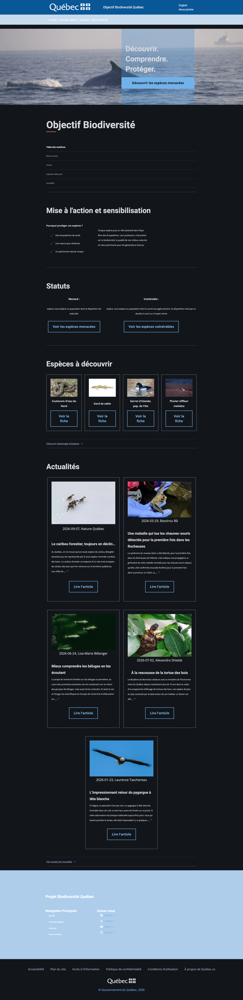
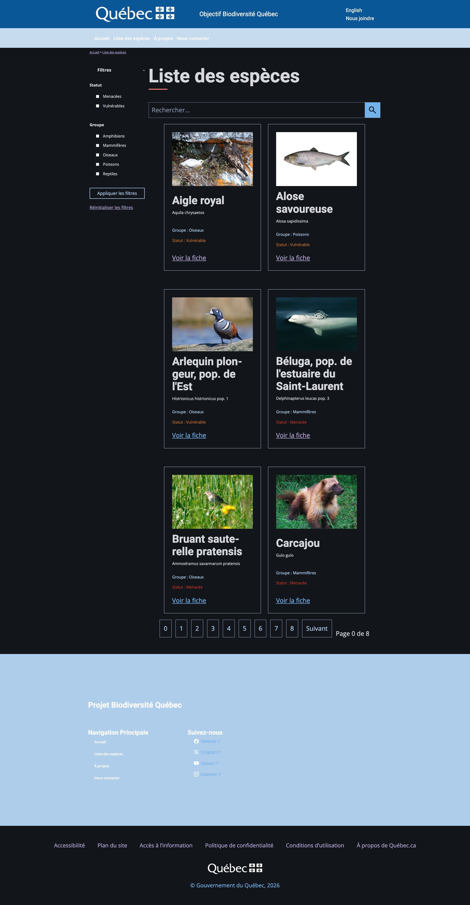
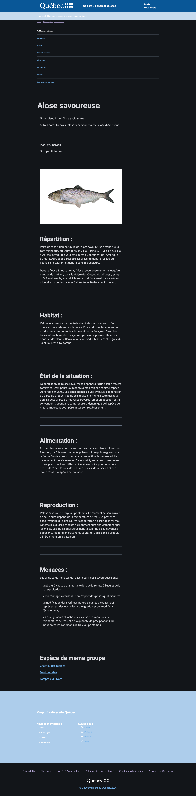

# Projet 1 - Objectif Biodiversité Québec

La première partie est commune à l'équipe.
La seconde partie "Mon processus" est à compléter individuellement.

**Ceci est notre solution d'équipe pour le projet Objectif Biodiversité Québec.**

## Sommaire

- [Présentation](#présentation)
  - [Capture écran](#capture-écran)
  - [Liens](#liens)
  - [Disparition des tâches]()
- [Mon processus](#mon-processus)
  - [Technologies utilisées](#technologies-utilisées)
  - [Ce que j'ai appris](#ce-ce-que-jai-appris)
  - [Développement continu](#développement-continu)
- [Auteur](#auteur)

## Présentation

Projet Biodiversité Québec est un site internet comportant plusieurs espèces 
en danger. Celles-ci sont considérées comme "vulnérables" ou "menacées". Ce
site web permet alors de découvrir et d'en apprendre davantage sur ces pauvres
espèces menacées.

### Capture écran

### Liens

- URL de la solution : [MaxaA-int - Projet01 Biodiversité](https://github.com/MaxaA-int/Projet01_Biodiversite)
- URL du site en direct : [Timunix - scriptCase - Biodiversité](https://timunix3.csfoy.ca/~scriptCase/objectifBiodiversite/public/)

### Dispatition des tâches

**Max :**

*Pré-projet :*
- Complétion du document **Analyse des concurrents**
- Complétion du **Diagramme des cas d'utilisation**

*Figma :*
- Création de l'esquisse Figma **Accueil - Table / Mobile**
- Création de l'esquisse Figma **Liste des espèces - Table**
- Création de l'esquisse Figma **Fiche de l'espèces - Table**
- Création complète de la maquette Figma **Accueil - Table / Mobile**
- Création complète de la maquette Figma **Liste des espèces - Table / Mobile**

*Programmation / Intégration :*
- Création complète de la page **Accueil - Table / Mobile**
- Création complète de la page **Liste des espèces - Table / Mobile**

-----

**Gab :**

*Pré-projet :*
- Création du tableau **Planner**

*Figma :*
- Adaptation de l'esquisse Figma **Liste des espèces - Mobile**
- Adaptation de l'esquisse Figma **Fiche de l'espèces - Mobile**
- Création complète de la maquette Figma **Fiche d'une espèce - Table / Mobile**

*Programmation / Intégration :*
- Création complète de la page **Fiche d'une espèce - Table / Mobile**

------

## Mon Processus

### Technologies utilisées

Max :

Dans ce projet, plusieurs technologies ont été utilisées afin de parvenir à un résultat concret. Il y a, certes, l'utilisation
commune du HTML, CSS et Javascript, mais le PHP fait enfin son apparition ! De plus, L'utilisation du système de design du Québec
est une nouveauté permettant d'améliorer nos compétences professionnelles.

Gab :

blablabla

### Ce que j'ai appris

Max :

Grâce à ce projet, j'ai pu apprendre davantage ce merveilleux langage de programmation que j'ai surnommé : PHP.
En continu avec les cours de programmation web et multimédia, ce projet a permis de renforcer mes connaissances et 
d'appliquer les enseignements dans divers contextes. De plus, j'ai pu expérimenter avec quelques notions CSS auquelles
j'avais très légèrement touché auparavant. Par exemple, en PHP, j'ai pu créer un système de filtrage. En CSS, j'ai pu 
développer les propriétés `object-fit/position` afin de créer une bannière Hero.

Gab : 

balbalbal

### Développement continu

Pour mes prochains projets, je souhaite approfondir :

Max :

Je souhaite continuer le renforcement des connaissances en PHP afin de m'habituer davantage. Je souhaite aussi 
utiliser plus souvent les grilles CSS.

Gab : 

aa

## Auteur

- Maxime Riverin
- Gabriel Lavictoire
